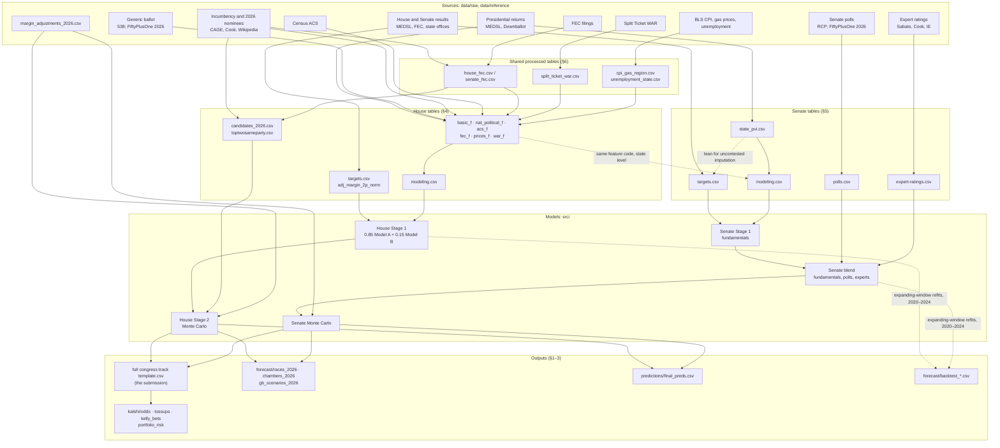

# Dataset Schemas: Processed and Final Outputs

Column-level schemas for `data/processed/` and `predictions/`, with each column's type, meaning and one example
value. The examples follow one race where they can: **PA-07** (2024 actual result; 2026 forecast). How each table is
built, and every correction and caveat, is in the `data-processing/` READMEs. This file only describes the columns.

> `data/csv_schemas.md` is an earlier *proposed* layout and doesn't match these files. Use this one.

## Data flow

How the data moves from sources to the submission. Section numbers (§) point to the schemas below.

**In words:**
1. **Sources to processed tables.** `data-processing/` scripts build the targets (observed results, with uncontested
   races imputed) and the predictor tranches. The House tranches are joined into `modeling.csv`. The Senate builds the
   same tranches at state level, plus `polls.csv` and `expert-ratings.csv`.
2. **Stage 1.** A regression of `targets.csv`'s `adj_margin_2p_norm` on `modeling.csv` predicts each race's
   Democratic two-party margin. In the Senate, that margin is then blended with polls and expert ratings.
3. **Stage 2.** Manual margin adjustments are added, and a Monte Carlo with national, state and race errors turns
   the margins into win probabilities and seat distributions. House races decided by rule (uncontested, same-party
   top-two, against third parties only) use `candidates_2026.csv` and `toptwosameparty.csv`.
4. **Outputs.** `notebooks/full-forecast/full_forecast_2026.ipynb` writes the submission, the race and chamber tables,
   the generic-ballot scenarios and `final_preds.csv`. `src/kalshi/run.py` compares the submission with Kalshi
   prices. The backtest notebook reruns the pipeline on 2020–2024.

## Conventions

| Convention | Meaning |
|---|---|
| Margin sign | Democratic-positive, in points (0–100 scale). `-1.0` means R+1 |
| `_raw` | Share or margin over **all** votes (or all respondents) |
| `_2p_norm` | Share or margin over **D + R only** (two-party) |
| `_pct` | Share of the total, 0–100 |
| `dem_` / `gop_` / `3p_` / `ind_` | Democrat (or caucusing independent), Republican, third-party, other independent |
| House key | `year, state, district`. `district` is 1..n, **0 for at-large** |
| Senate key | `year, state, class` (class 1/2/3). `special` marks a special election |
| `race_id` (2026 outputs) | `PA-07`, `AK-AL` (House at-large), `PA-SEN` (Senate) |
| Party codes | `D`, `R`, `I` (independent) in outputs; `OTHER` inside the simulation |
| Ratings | From the pick's probability: Toss-up < 0.60 ≤ Lean < 0.75 ≤ Likely < 0.95 ≤ Safe |
| Blanks | A blank means missing. Nothing is filled with 0 unless the column says so |
| Types | `int`, `float`, `str`, `bool`, `date` (`YYYY-MM-DD`), `month` (`YYYY-MM`) |

---

## 1. Final forecast outputs

### Submission track: `data/processed/full congress track template.csv`

The submitted forecast: one row per 2026 race (470 = 435 House + 35 Senate). `full_congress_track_2026.csv` is an
identical copy. The same five columns are used by:
- `house/congress_track_house_2026.csv` (435 rows): the House model only, without the full forecast's adjustments.
- `senate/congress_track_senate_2026.csv` (35 rows) and its `_sm0` / `_sm1` / `_sm2` variants: the Senate model under
  error models S-M0 (production), S-M1 (separate polled/unpolled race scales) and S-M2 (regional error).
- `scenarios/generic_ballot_tracks.csv`: the same rows with a leading `scenario` (`R+4`, `baseline`, `D+4`).

| Column | Type | Description | Example |
|---|---|---|---|
| `race_id` | str | Race identifier | `PA-07` |
| `chamber` | str | `House` or `Senate` | `House` |
| `predicted_winner_party` | str | Party of the predicted winner (`D`, `R`, `I`) | `D` |
| `candidate_name` | str | The predicted winner | `Bob Brooks` |
| `win_probability` | float | Probability that this candidate wins (always ≥ 0.5) | `0.694775` |

### `predictions/final_preds.csv`

The submission plus margin intervals, generic-ballot stress tests and Polymarket's price. One row per race (470).
Every margin and probability is the **submitted candidate's**, so a positive margin means that candidate wins.

| Column | Type | Description | Example |
|---|---|---|---|
| `race_id`, `chamber`, `predicted_winner_party`, `candidate_name` | str | The submission's row | `PA-07`, `House`, `D`, `Bob Brooks` |
| `predicted_margin` | float | Predicted two-party margin over the runner-up (the simulated center). Blank for races decided by rule | `2.9475` |
| `predicted_80_low` | float | 10th percentile of the simulated margin | `-4.78694` |
| `pred_80_high` | float | 90th percentile of the simulated margin | `10.739278` |
| `win_probability` | float | The submitted probability | `0.694775` |
| `gen_ballot_less4` | float | Win probability with the generic ballot 4 points more Republican | `0.5218` |
| `gen_ballot_plus4` | float | Win probability with the generic ballot 4 points more Democratic | `0.8288` |
| `polymarket_odd` | float | Polymarket's current probability for the candidate | `0.979366` |
| `polymarket_delta` | float | `win_probability − polymarket_odd` (positive: the model is more confident) | `-0.284591` |

### `forecast/races_2026.csv`

The full forecast's race table: one row per race (470). It has the margins, side probabilities and ratings for the
adjusted forecast, the unadjusted model, and each generic-ballot shift.

| Column | Type | Description | Example |
|---|---|---|---|
| `race_id`, `chamber` | str | Race | `PA-07`, `House` |
| `race_type` | str | House lineup (`dr`, `dr_jungle`, `dr_rcv`, `dem_vs_dem`, `gop_vs_gop`, `dem_vs_3p`, `dem_uncontested`, …); Senate seat type (`dem_nominee`, `independent_only`) | `dr` |
| `dem_candidate`, `gop_candidate` | str | Each side's candidate. In an independent-vs-R Senate race, `dem_candidate` is the independent | `Bob Brooks`, `Ryan Mackenzie` |
| `margin_model` | float | The model's margin (House Stage 1; Senate blend or rating center). Blank for a House race decided by rule | `2.9475` |
| `margin_adjustment` | float | Manual adjustment from `data/reference/margin_adjustments_2026.csv` (D-positive) | `0.0` |
| `margin` | float | `margin_model + margin_adjustment`: the simulated center | `2.9475` |
| `p_dem`, `p_gop`, `p_other` | float | Each side's share of simulations. Other = third party or independent | `0.694775`, `0.305225`, `0.0` |
| `predicted_winner_party`, `candidate_name`, `win_probability` | str/float | The submission's row | `D`, `Bob Brooks`, `0.694775` |
| `rating` | str | Rating of the adjusted forecast | `Lean D` |
| `dem_2p_norm`, `gop_2p_norm` | float | Two-party vote shares implied by `margin` (`50 ± margin/2`) | `51.47375`, `48.52625` |
| `p_dem (model)`, `p_other (model)`, `rating (model)` | float/str | The same, without margin adjustments | `0.694775`, `0.0`, `Lean D` |
| `p_dem (S)`, `p_other (S)`, `rating (S)` | float/str | The same, for each generic-ballot shift S ∈ {`R+4`, `R+2`, `D+2`, `D+4`} | `p_dem (R+4)` = `0.5218` |

### `forecast/gb_scenarios_2026.csv`

The race table in long form, stacked across the five generic-ballot runs (5 × 470 = 2,350 rows).

| Column | Type | Description | Example |
|---|---|---|---|
| `scenario` | str | `R+4`, `R+2`, `adjusted` (the submission), `D+2`, `D+4` | `R+4` |
| `gb_shift` | float | Shift applied to the generic ballot, in points | `-4.0` |
| `generic_ballot` | float | The resulting generic-ballot margin (D − R) | `4.7` |
| `race_id` … `rating` | | The same as `races_2026.csv`'s first 15 columns (no `_model` columns) | `margin` = `0.288841` |

### `forecast/chambers_2026.csv`

Chamber-level summary, one row per run (`model`, `adjusted`, `R+4`, `R+2`, `D+2`, `D+4`).
`scenarios/generic_ballot_chambers.csv` has the same columns, with `scenario` (`R+4`, `baseline`, `D+4`) in place of `run`.

| Column | Type | Description | Example (`adjusted`) |
|---|---|---|---|
| `run` | str | Forecast run | `adjusted` |
| `generic ballot (D - R)` | float | National generic-ballot margin used | `8.7` |
| `House: mean race shift` | float | Mean change in House race margins against the unadjusted model | `0.038369` |
| `House: median D seats` | float | Median Democratic House seats across simulations | `233.0` |
| `House: D seats 10%-90%` | str | 80% interval of Democratic House seats | `223–245` |
| `House: P(D 218+)` | float | Probability of a Democratic House majority | `0.966275` |
| `House: races called D` | int | Races whose pick is a Democrat | `229` |
| `Senate: mean race shift (D nominees)` | float | Mean change in Senate margins, races with a D nominee | `0.078125` |
| `Senate: median D-caucus seats` | float | Median Democratic-caucus seats (holdovers included) | `52.0` |
| `Senate: D-caucus seats 10%-90%` | str | 80% interval of D-caucus seats | `49–54` |
| `Senate: P(D control)` | float | Probability of Democratic control | `0.74015` |
| `Senate: races called D` | int | Senate races whose pick is a Democrat | `18` |

---

## 2. Backtests (`data/processed/forecast/`)

The full forecast rerun on 2020, 2022 and 2024, each year fit only on earlier elections.

### `backtest_races.csv`

One row per race and test year (1,405 rows).

| Column | Type | Description | Example |
|---|---|---|---|
| `year` | int | Test year | `2024` |
| `race_id`, `chamber`, `race_type` | str | Race. The Senate `race_type` is `polled` / `unpolled` | `PA-07`, `House`, `dr` |
| `dem_candidate`, `gop_candidate` | str | Nominees | `Susan Wild`, `Ryan E. Mackenzie` |
| `incumbent` | str | `D`, `R` or `open` | `D` |
| `margin_model`, `margin_adjustment`, `margin` | float | As in `races_2026.csv` | `1.331323`, `0.0`, `1.331323` |
| `actual` | float | Observed two-party margin (blank where none is valid) | `-1.007156` |
| `p_dem`, `p_gop`, `p_other` | float | Simulated side probabilities | `0.59285`, `0.40715`, `0.0` |
| `winner_party` | str | Actual winner (`D`, `R`, `I`) | `R` |
| `treatment` | str | How the race is simulated: `simulated` (D vs R), `fixed` (uncontested), `third_party`, `same_party` | `simulated` |
| `predicted_winner_party`, `party_probability` | str/float | The most likely side and its probability | `D`, `0.59285` |
| `rating` | str | Rating | `Toss-up` |
| `called_right` | bool | Pick equals the winner | `False` |
| `dem_2p_norm`, `gop_2p_norm` | float | Shares implied by `margin` | `50.665662`, `49.334338` |
| `error (D+)` | float | `actual − margin` (positive: Democrats beat the forecast) | `-2.338479` |
| `p_dem (model)`, `rating (model)` | float/str | Without margin adjustments | `0.59285`, `Toss-up` |

### `backtest_scorecard.csv`

One row per chamber and year (`2020`, `2022`, `2024`, `pooled`).

| Column | Type | Description | Example (House 2024) |
|---|---|---|---|
| `chamber`, `year` | str | Group | `House`, `2024` |
| `races`, `called right`, `accuracy`, `misses` | float | Race calls | `435`, `428`, `0.983908`, `7` |
| `not Safe`, `misses among not Safe` | float | Races rated below Safe, and the misses among them | `62`, `7` |
| `Brier` | float | Brier score of the win probabilities | `0.013608` |
| `expected D wins`, `called D wins`, `actual D wins` | float | Sum of `p_dem`; races called D; races won by D | `217.23`, `218`, `215` |
| `all: margin n`, `all: MAE`, `all: RMSE`, `all: bias (D+)` | float | Margin errors over races with an `actual` | `398`, `4.31`, `5.87`, `-1.44` |
| `not Safe: margin n`, `not Safe: MAE`, `not Safe: RMSE`, `not Safe: bias (D+)` | float | The same, non-Safe races only | `62`, `3.85`, `5.74`, `-1.56` |

### `backtest_top_two.csv`

Same-party top-two races (CA/WA), 2020–2024, predicted from the primary and fundraising. One row per race.

| Column | Type | Description | Example |
|---|---|---|---|
| `year`, `state`, `district`, `race_id` | int/str | Race | `2020`, `CA`, `12`, `CA-12` |
| `leader`, `runner_up` | str | Primary leader and runner-up | `Pelosi, Nancy`, `Buttar, Shahid` |
| `margin_primary`, `margin_fundraising`, `margin_poll` | float | Leader's margin implied by each input (poll blank if none) | `70.22`, `10.89`, blank |
| `weights` | str | Weights of the inputs used | `primary 0.6, fundraising 0.4` |
| `uncommitted_share` | float | Primary share of voters with no finalist of their party | `13.01` |
| `mean`, `sd` | float | Predicted leader margin and its SD | `46.49`, `8.90` |
| `interval_80_low`, `interval_80_high` | float | 80% interval of the leader's margin | `36.31`, `56.66` |
| `p_leader`, `p_runner_up` | float | Win probabilities | `0.999455`, `0.000545` |
| `winner`, `predicted` | str | Actual and predicted winner | `Pelosi, Nancy` |
| `actual_margin`, `error` | float | Observed leader margin; `actual_margin − mean` | `55.27`, `8.78` |
| `called_right`, `inside_80` | bool | Correct call; actual inside the 80% interval | `True`, `True` |

### `backtest_kalshi_2024.csv` and `backtest_kalshi_2024_bets.csv`

- **`backtest_kalshi_2024.csv`:** `backtest_races.csv`'s columns for the 2024 races with a Kalshi market (42), plus
  `kalshi_p_dem` (Kalshi's election-eve Democratic probability), `dem_won` (bool) and `model_minus_kalshi`
  (`p_dem − kalshi_p_dem`). Example: PA-10, `p_dem` 0.057, `kalshi_p_dem` 0.437, `model_minus_kalshi` −0.380.
- **`backtest_kalshi_2024_bets.csv`:** the 2026 bet-sizing rule replayed on 2024 eve prices. It has the columns of
  `kelly_bets_2026.csv` (§3), plus `result` (`yes` / `no`, the market's resolution) and `realized_profit`. Example:
  ME-02 YES on Theriault at 0.33, 182 contracts, `realized_profit` −62.88.

---

## 3. Kalshi and betting (`data/processed/kalshi/`, `data/processed/scenarios/`)

### `kalshi_markets_2026.csv`

One row per Kalshi winner market (951; usually one per candidate) from the latest cached pull.
`kalshi_odds_log_2026.csv` appends every pull, with a leading `pulled_at` (e.g. `2026-11-03T0912Z`).

| Column | Type | Description | Example |
|---|---|---|---|
| `race_id` | str | Race | `PA-07` |
| `event_ticker`, `market_ticker` | str | Kalshi event (race) and market (candidate) | `HOUSEPA7-26`, `HOUSEPA7-26-D` |
| `candidate`, `party` | str | Market's candidate and party | `Bob Brooks`, `D` |
| `status` | str | Market status | `active` |
| `yes_bid`, `yes_ask`, `no_ask` | float | Top-of-book prices, in dollars per $1 contract | `0.89`, `0.90`, `0.11` |
| `yes_ask_size`, `yes_bid_size` | float | Contracts quoted at those prices | `1345.01`, `501.0` |
| `last_price`, `volume`, `open_interest` | float | Last trade, volume traded, open contracts | `0.90`, `267887.83`, `95926.36` |
| `price` | float | Bid–ask midpoint (else the last trade) | `0.895` |
| `kalshi_prob` | float | `price` normalized to sum to 1 within the event | `0.886139` |

### `kalshi_odds_2026.csv`

The submission's 470 rows (5 track columns) beside Kalshi's price for each pick.

| Column | Type | Description | Example |
|---|---|---|---|
| `race_id` … `win_probability` | | The submission's row | `PA-07`, …, `0.694775` |
| `kalshi_event` | str | Matched event | `HOUSEPA7-26` |
| `match` | str | How the pick's market was found: `party`, `name` or `none` | `party` |
| `kalshi_favorite`, `kalshi_favorite_party`, `kalshi_favorite_prob` | str/float | Kalshi's most likely candidate | `Bob Brooks`, `D`, `0.886139` |
| `kalshi_event_volume` | float | Total volume across the event's markets | `424961.2` |
| `kalshi_market`, `kalshi_candidate`, `kalshi_party` | str | The pick's market | `HOUSEPA7-26-D`, `Bob Brooks`, `D` |
| `kalshi_winner_prob` | float | Kalshi's probability for the pick | `0.886139` |
| `yes_bid`, `yes_ask` | float | The pick's market quotes | `0.89`, `0.90` |
| `names_agree` | bool | The market's surname equals the pick's | `True` |
| `picks_agree` | bool | The pick is Kalshi's favorite | `True` |

### `tossups_2026.csv` and `proposed_overrides_2026.csv`

**`tossups_2026.csv`:** the `kalshi_odds_2026.csv` rows where the model's pick is at most 0.60, or Kalshi puts it at
0.40–0.60 (31 races). It adds these columns:

| Column | Type | Description | Example (MT-01) |
|---|---|---|---|
| `model_close`, `market_close` | bool | Which side calls it close | `False`, `True` |
| `blend_prob` | float | `0.5 × win_probability + 0.5 × kalshi_winner_prob` | `0.537558` |
| `flip` | bool | `blend_prob < 0.5`: the blend would switch the pick | `False` |
| `proposed_party`, `proposed_candidate`, `proposed_probability` | str/float | The blended pick | `R`, `Aaron Flint`, `0.537558` |
| `expected_brier_submitted`, `expected_brier_proposed` | float | Expected Brier score under the blend, for the submitted and proposed reports | `0.267`, `0.249` |

**`proposed_overrides_2026.csv`:** the blended picks, in the format of the retired overrides file. They aren't applied
to the submission. The columns are the 5 track columns (the proposal), then `model_party`, `model_candidate`,
`model_probability` and `reason` (free text).

### `kelly_bets_2026.csv`

Quarter-Kelly bets on the toss-ups, using the submission's probability as the belief (30 rows). These are
recommendations only; nothing places an order. `scenarios/generic_ballot_resized_bets.csv` has the same columns,
re-sized under each generic-ballot scenario, with a leading `scenario`.

| Column | Type | Description | Example |
|---|---|---|---|
| `race_id`, `market_ticker`, `candidate` | str | Market bet on | `MT-01`, `HOUSEMT1-26-D`, `Sam Forstag` |
| `side` | str | `yes` or `no` | `no` |
| `price` | float | Quoted price of that side | `0.40` |
| `cost` | float | Price plus Kalshi's taker fee, per contract | `0.4168` |
| `size_at_price` | float | Contracts available at that price | `25.0` |
| `belief` | float | Model probability that the side pays | `0.674125` |
| `edge` | float | `belief − cost` | `0.257325` |
| `kelly` | float | Full-Kelly fraction, `edge / (1 − cost)` | `0.441229` |
| `kelly_stake`, `kelly_contracts` | float/int | Quarter-Kelly stake and contracts, before the size cap | `30.02`, `72` |
| `contracts`, `stake` | int/float | After capping at `size_at_price` | `25`, `10.42` |
| `expected_profit` | float | `contracts × edge` | `6.433` |

### `portfolio_risk_2026.csv`, `portfolio_stress_bets_2026.csv`, `scenarios/generic_ballot_kalshi.csv`

- **`portfolio_risk_2026.csv`:** one row per scenario (`R+4` … `D+4`), with the fixed Kelly portfolio scored in every
  simulation. Columns: `scenario`, `generic ballot (D - R)`, `expected profit`, `sd`, `P(loss)`, `5th percentile`,
  `1st percentile`, `worst simulation`, `best simulation`, `stake`, `expected return on stake`. Example (`adjusted`):
  expected profit 590.80 on a stake of 786.95, `P(loss)` 0.0246.
- **`portfolio_stress_bets_2026.csv`:** one row per bet (`race_id`, `candidate`, `side`, `stake`), then that bet's
  expected profit under each scenario (`R+4`, `R+2`, `adjusted`, `D+2`, `D+4`). Example: MT-01 NO, 10.01 at R+4 and
  2.03 at D+4.
- **`scenarios/generic_ballot_kalshi.csv`:** one row per scenario (`R+4`, `baseline`, `D+4`). Columns:
  `fixed bets: stake`, `fixed bets: expected profit`, `fixed bets: losing in expectation`, `fixed bets: unpriced`,
  `re-sized bets: n`, `re-sized bets: stake`, `re-sized bets: expected profit`.

### `kalshi_2024_eve.csv`

Kalshi's 2024 election-eve prices, one row per market (89).

| Column | Type | Description | Example |
|---|---|---|---|
| `chamber`, `state`, `district`, `class`, `special` | str/float | Race (district for House; class and special for Senate) | `House`, `PA`, `7` |
| `event_ticker`, `market_ticker` | str | Kalshi tickers | `HOUSEPA7-24`, `HOUSEPA7-24-D` |
| `candidate`, `party` | str | Market's candidate | `Susan Wild`, `D` |
| `result` | str | Resolution, `yes` / `no` | `no` |
| `eve_yes_bid`, `eve_yes_ask`, `eve_price` | float | Election-eve quotes and midpoint | `0.75`, `0.76`, `0.755` |
| `eve_candle_end` | str | Timestamp of the price candle used | `2024-11-05T05:00:00+00:00` |
| `volume_through_eve` | float | Volume traded through the eve | `3339.0` |
| `eve_prob` | float | Midpoint normalized within the event | `0.755` |

---

## 4. House modeling data (`data/processed/house/`)

### `targets.csv`: Stage 1 targets

One row per House general election, 2006–2024 (4,350 rows; key `year, state, district`). `targets_raw.csv` has the
same columns for 1976–2024 (10,875 rows), exactly as observed: no imputation and no races treated as uncontested.

| Column | Type | Description | Example (PA-07 2024) |
|---|---|---|---|
| `year`, `state`, `district` | int/str/int | Key | `2024`, `PA`, `7` |
| `dem_votes`, `gop_votes`, `3p_votes`, `total_votes` | float | Votes by party (fusion lines summed); `total_votes` = D + R + 3p | `199626`, `203688`, `0`, `403314` |
| `dem_pct`, `gop_pct`, `3p_pct` | float | Shares of `total_votes` | `49.50`, `50.50`, `0.0` |
| `margin_votes` | float | D − R votes | `-4062` |
| `margin_raw` | float | D − R over `total_votes` | `-1.007156` |
| `margin_2p_norm` | float | D − R over D + R | `-1.007156` |
| `race_type` | str | Lineup: `dr`, `dr_multi`, `dr_writein`, `dr_jungle`, `dr_rcv`, `dem_vs_3p`, `gop_vs_3p`, `dem_uncontested`, `gop_uncontested`, `dem_vs_dem`, `gop_vs_gop`, `cross_endorsed`, `no_major_party` | `dr` |
| `winner_party` | str | `D`, `R` or other | `R` |
| `dem_candidate_count`, `gop_candidate_count`, `3p_candidate_count` | int | Named candidates by party | `1`, `1`, `0` |
| `is_rcv`, `is_special_election` | bool | Ranked-choice; special election | `False`, `False` |
| **`adj_margin_2p_norm`** | float | **The Stage 1 target.** Observed `margin_2p_norm`, or the imputed value for uncontested races | `-1.007156` |
| `dem_votes_imputed`, `gop_votes_imputed` | float | Imputed votes (imputed rows only) | blank |
| `is_imputed` | bool | Target is imputed | `False` |
| `imputation_method` | str | `state_mean_residual` or `national_shave` | blank |
| `needs_imputation` | bool | No observed target (stays True after imputation) | `False` |
| `is_nonstandard_race` | bool | `race_type` is anything but `dr` / `dr_multi` | `False` |
| `source_totalvotes` | int | Source's own total | `403314` |
| `nonvote_votes` | int | Blank/void/over-/under-vote rows left out of `total_votes` | `0` |
| `is_unofficial` | bool | MEDSL's unofficial flag | `False` |
| `quality_flags` | str | `;`-separated row issues (e.g. `runoff_in_source`, `writein_treated_uncontested`) | blank |
| `source` | str | Source and version | `MEDSL U.S. House 1976-2024 (version 20250910)` |

### `targets_supp.csv` and `targets_candidates.csv`

Reference data. Neither is joined into the targets.

- **`targets_supp.csv`** (key `year, state, district, contest`): every contest of the districts that have more than one
  (runoffs, specials), plus jungle/RCV first rounds and the actual result of the imputed `*_vs_3p` races. Its columns
  are `targets.csv`'s vote, margin, `race_type`, count and provenance columns, without the target/imputation columns,
  plus `contest` (`first_round`, `runoff`, `special`). Example: LA-05 2020, `runoff` row, `race_type` `gop_vs_gop`,
  `gop_votes` 79,307.
- **`targets_candidates.csv`** (key `… contest, candidate`): one row per candidate of each `targets_supp.csv` contest.

  | Column | Type | Description | Example |
  |---|---|---|---|
  | `year`, `state`, `district`, `contest` | | Contest key | `2020`, `LA`, `5`, `first_round` |
  | `candidate` | str | As spelled in the source | `LUKE J LETLOW` |
  | `parties` | str | Ballot lines, `; `-separated | `REPUBLICAN` |
  | `party_group` | str | `D`, `R`, `3P`, `D+R`, `nonvote` | `R` |
  | `is_candidate`, `is_writein` | bool | Real candidate (not aggregate/non-vote); all lines write-in | `True`, `False` |
  | `votes` | int | Votes summed across lines | `102533` |
  | `source` | str | Source | `MEDSL …; Louisiana SOS official results (2020-11-03)` |

### `modeling.csv`: Stage 1 predictors

One row per district-year, 2006–2026 (4,785 rows; key `year, state, district`). It has **no targets**; join
`targets.csv` on the key. Its 80 columns are the feature tranches below, joined in this order. Each tranche is also
saved as its own file with the key.

| Tranche file | Columns | Join |
|---|---|---|
| `basic_f.csv` | `gen_margin_raw`, `partisan_lean`, `inc_signed` | key |
| `acs_f.csv` | `acs_vintage` … `rel_state_hispanic` (22) | key |
| `fec_f.csv` | `fundraising_advantage`, `spending_advantage`, `small_dollar_share_diff`, `dem_fec_missing`, `gop_fec_missing` | key |
| `prices_f.csv` | `census_region`, `price_data_month`, the 18 CPI/gas features (§6), the 8 unemployment features (§6) | key |
| `war_f.csv` | `war_lag`, `war_lag_available` | key |
| `nat_political_f.csv` | 17 `gb_*` generic-ballot columns | `year` |

**`basic_f.csv`**

| Column | Type | Description | Example (PA-07 2024) |
|---|---|---|---|
| `gen_margin_raw` | float | National generic-ballot margin (D − R, all respondents) | `0.67808` |
| `partisan_lean` | float | District lean, `2 × PVI`, from the two previous presidential elections (0.75 / 0.25) | `-4.340618` |
| `inc_signed` | int | +1 D incumbent running, −1 R, 0 open | `1` |

**`acs_f.csv`** (Census ACS; percentages 0–100)

| Column | Type | Description | Example |
|---|---|---|---|
| `acs_vintage` | str | ACS product used (`2024_1yr`, `2016-2020_5yr`, `2024_1yr_rebuilt`) | `2024_1yr` |
| `white`, `black`, `hispanic` | float | Non-Hispanic White, non-Hispanic Black, Hispanic shares | `64.96`, `5.29`, `22.51` |
| `college` | float | Bachelor's or higher, adults 25+ | `33.4` |
| `median_income` | int | Median household income, nominal dollars | `82166` |
| `median_age` | float | Median age | `41.3` |
| `moved_within_past_yr` | float | Moved house in the past year | `8.89` |
| `foreign_born` | float | Foreign-born share | `12.03` |
| `unemployment` | float | ACS unemployment rate | `5.54` |
| `poverty` | float | Below the poverty line | `10.07` |
| `avg_household_size` | float | People per household | `2.55` |
| `housing_burden` | float | Households spending 30%+ of income on housing | `33.01` |
| `rel_college`, `rel_state_college` | float | District − national / state college share (pp) | `-3.45`, `-2.97` |
| `log_rel_income`, `log_rel_state_income` | float | log(district ÷ national / state median income) | `0.0069`, `0.0579` |
| `rel_unemployment`, `rel_state_unemployment` | float | District − national / state unemployment (pp) | `0.91`, `1.19` |
| `rel_housing_burden`, `rel_state_housing_burden` | float | District − national / state housing burden (pp) | `0.03`, `4.58` |
| `rel_state_hispanic` | float | District − state Hispanic share (pp) | `13.09` |

**`fec_f.csv`** (from `house_fec.csv`, §6)

| Column | Type | Description | Example |
|---|---|---|---|
| `fundraising_advantage` | float | `log1p(D receipts) − log1p(R receipts)`, capped at ±5 | `1.738406` |
| `spending_advantage` | float | The same for disbursements, capped at ±5 | `1.884707` |
| `small_dollar_share_diff` | float | D − R unitemized share of individual contributions | `-0.002374` |
| `dem_fec_missing`, `gop_fec_missing` | bool | No usable FEC record (amounts set to 0) | `False`, `False` |

**`war_f.csv`**

| Column | Type | Description | Example |
|---|---|---|---|
| `war_lag` | float | The nominees' lagged Split Ticket WAR (0.75 / 0.25 of their two most recent earlier WAR races, D-positive); 0 where none | `0.103191` |
| `war_lag_available` | bool | Whether any earlier WAR exists | `True` |

**`nat_political_f.csv`** (key `year`; FiveThirtyEight's average, FiftyPlusOne for 2026)

| Column | Type | Description | Example (2024) |
|---|---|---|---|
| `gb_cutoff_date` | date | Day before Election Day | `2024-11-04` |
| `gb_date` | date | Date of the average used (latest at or before the cutoff) | `2024-11-04` |
| `gb_margin_raw`, `gb_margin_2p_norm` | float | Generic-ballot margin, raw and two-party | `0.67808`, `0.737446` |
| `gb_dem_pct`, `gb_gop_pct`, `gb_und_pct` | float | D, R, undecided shares | `46.31`, `45.64`, `8.05` |
| `gb_dem_hi`, `gb_dem_lo`, `gb_gop_hi`, `gb_gop_lo` | float | Upper/lower bands of the average (blank for 2026) | `48.70`, `43.93`, `47.72`, `43.56` |
| `gb_margin_30d_mean_raw`, `gb_margin_30d_mean_2p_norm` | float | 30-day mean margin | `1.042661`, `1.126154` |
| `gb_margin_30d_ewma_raw`, `gb_margin_30d_ewma_2p_norm` | float | 30-day exponentially weighted mean | `1.000619`, `1.085679` |
| `gb_momentum_30d_raw`, `gb_momentum_30d_2p_norm` | float | Change in the margin over 30 days | `-1.198564`, `-1.304445` |

### `candidates_2026.csv`

One row per listed 2026 House general-election candidate (1,158).

| Column | Type | Description | Example |
|---|---|---|---|
| `year`, `state`, `district` | | Key | `2026`, `PA`, `7` |
| `candidate_id` | str | FEC candidate ID (blank if none matched) | `H6PA07188` |
| `candidate_name` | str | Name | `Bob Brooks` |
| `party`, `party_label` | str | Ballot party (`D` / `R` / other) and the source's label | `D`, `Democratic` |
| `model_party` | str | Slot for Stage 1 (equals `party`, except the independent Republican proxy, Kiley CA-6) | `D` |
| `ballot_status` | str | `listed_general_election` | `listed_general_election` |
| `race_type` | str | Lineup (as in the targets) | `dr` |
| `election_method` | str | `standard`, `top_two`, `jungle`, `rcv` | `standard` |
| `as_of_date` | date | Date of the pinned source revision | `2026-10-30` |
| `data_flags` | str | `no_fec_record`, `fec_ambiguous`, `independent_as_gop` | blank |
| `source` | str | Source revision and citation | `Wikipedia rev 1382821364; cites …` |

### `toptwosameparty.csv` and `toptwosameparty_history.csv`

**`toptwosameparty.csv`:** one row per finalist in the 2026 same-party top-two races (18 candidates, 9 CA districts).
Key `year, state, district, candidate_id`.

| Column | Type | Description | Example (CA-07) |
|---|---|---|---|
| `candidate_id`, `candidate_name`, `party`, `race_type` | str | Finalist | `H6CA07175`, `Mai Vang`, `D`, `dem_vs_dem` |
| `fec_status` | str | FEC incumbent/challenger/open status | `CHALLENGER` |
| `primary_date`, `primary_ballot_name` | date/str | June primary | `2026-06-02`, `Mai Vang` |
| `primary_votes`, `primary_rank`, `primary_total_votes` | int | Primary votes, rank, total cast | `65617`, `1`, `210115` |
| `primary_share`, `primary_share_top_two` | float | Share of all votes; of the two finalists' votes | `31.23`, `51.78` |
| `primary_dem_share`, `primary_gop_share` | float | Race-level party shares in the primary | `63.04`, `36.96` |
| `poll_share`, `poll_share_top_two`, `poll_count` | float/int | Poll share, two-way share, number of polls (blank if no poll) | `39.0`, `44.32`, `1` |
| `pollster`, `poll_end_date` | str | Not recorded yet | blank |
| `receipts`, `individual_contributions`, `self_funding`, `cash_on_hand` | float | FEC cycle-to-date, $ | `1828417.71`, … |
| `fec_coverage_end_date` | date | FEC coverage end | `2026-10-14` |
| `fundraising_advantage`, `individual_contribution_advantage` | float | `log1p(own) − log1p(opponent)`, receipts / individual contributions | `-1.4555`, `0.4062` |
| `source` | str | Sources | `CA SoS certified Statement of Vote …; FEC …` |

**`toptwosameparty_history.csv`:** the same kind of race, 2020–2024 (40 finalists), with outcomes. Columns: `year`,
`state`, `district`, `race_type`, `candidate_name`, `candidate_id`, `primary_votes`, `primary_total`,
`primary_share`, `primary_share_top_two`, `primary_rank`, `individual_contributions`,
`individual_contribution_advantage`, `fundraising_missing`, `poll_share_top_two`, `general_votes`,
`general_share_top_two`, `won`, `source`. Example: Pelosi, CA-12 2020, primary two-way share 85.1, general 77.6,
`won` True.

---

## 5. Senate modeling data (`data/processed/senate/`)

The Senate files follow the House schemas, keyed by `year, state, class`:

- **`targets.csv` / `targets_raw.csv`** (347 rows, 2006–2024): the House target columns, with `class` in place of
  `district`. Caucusing independents (King, Sanders) count as `dem_`. Example: PA 2024 class 1, `margin_2p_norm`
  −0.222821.
- **`targets_supp.csv` / `targets_candidates.csv`:** as in the House, plus `stage` (`general` / `runoff`) and
  `election_date`. Example: GA 2022, `runoff` row, `margin_2p_norm` 2.81.
- **`modeling.csv`** (382 rows, 2006–2026, 73 columns): the House `modeling.csv` columns, without the five
  `rel_state_*` ACS columns and the two `war_f` columns. ACS values are statewide. Its tranches (`basic_f`, `acs_f`, `fec_f`,
  `prices_f`, `nat_political_f`) are saved separately as in the House; `nat_political_f.csv` is identical to the House's.

### `polls.csv`: polling average per race

One row per race, 2006–2026 (382).

| Column | Type | Description | Example (PA 2024) |
|---|---|---|---|
| `year`, `state`, `class`, `special` | | Key | `2024`, `PA`, `1`, `False` |
| `election_id` | str | `<year>_<state>_<class>` | `2024_PA_1` |
| `election_date`, `cutoff_date`, `window_start` | date | Election Day; last day counted; window start (Election Day − 30) | `2024-11-05`, `2024-11-04`, `2024-10-06` |
| `poll_margin_dem` | float | Simple mean of eligible two-party poll margins (blank if none) | `2.6848` |
| `n_polls`, `n_pollsters` | float | Eligible polls; distinct pollster labels | `35`, `23` |
| `latest_poll_date` | date | Latest eligible poll's end date | `2024-11-04` |
| `poll_available` | bool | Average exists | `True` |
| `poll_source` | str | `RCP polls, simple mean of the window`, or the FiftyPlusOne file (2026) | `RCP polls, simple mean of the window` |
| `quality_flags` | str | e.g. `independent_vs_gop`, `independent_counted_as_dem` | blank |

### `polls_clean.csv`: individual polls

One row per poll question from RealClearPolling, 2006–2024 (4,893). Key `source_line`.

| Column | Type | Description | Example |
|---|---|---|---|
| `year`, `state`, `class`, `special`, `election_id` | | Race | `2024`, `PA`, `1`, `False`, `2024_PA_1` |
| `stage` | str | `general` or `runoff` | `general` |
| `rcp_table` | int | RCP table number within the state-year (>1 is usually a third-party version) | `1` |
| `pollster`, `pollster_raw` | str | Cleaned and source pollster labels | `Atlas Intel` |
| `pollster_partisan` | str | `D` / `R` if the label marks a partisan sponsor | blank |
| `start_date`, `end_date` | date | Fieldwork | `2024-11-03`, `2024-11-04` |
| `sample_size`, `sample_type` | float/str | n; `LV`, `RV`, `A`, `AV` | `1840`, `LV` |
| `dem_candidate`, `gop_candidate`, `ind_candidate` | str | The race's nominees | `CASEY, ROBERT P. (BOB), JR.`, … |
| `matchup` | str | Shares reported: `dem-gop`, `dem-gop-other`, `gop-other`, … | `dem-gop` |
| `dem_pct`, `gop_pct`, `other_pct` | float | Poll shares | `49`, `47`, blank |
| `margin_raw` | float | `dem_pct − gop_pct` | `2.0` |
| `poll_margin_dem` | float | Two-party margin, `100 × (D − R) / (D + R)` | `2.083333` |
| `is_duplicate`, `duplicate_of` | bool/float | Repeat of another poll, and that poll's `source_line` | `False`, blank |
| `quality_flags` | str | e.g. `date_fixed`, `independent_counted_as_dem` | blank |
| `source_line` | int | Line in the source file (key) | `4740` |

### `expert-ratings.csv`

One row per race, 2016–2026 (208). The scores are heuristic encodings of ordinal ratings, not calibrated probabilities.

| Column | Type | Description | Example (PA 2024) |
|---|---|---|---|
| `year`, `state`, `class`, `special`, `election_id` | | Race | `2024`, `PA`, `1`, `False`, `2024_PA_1` |
| `sabato_rating`, `cook_rating`, `ie_rating` | str | `Solid` / `Likely` / `Lean` / `Tilt` D or R, `Tossup` | `Lean D`, `Tossup`, `Tilt D` |
| `sabato_prob_dem`, `cook_prob_dem`, `ie_prob_dem` | float | Score: Solid 0.99, Likely 0.90, Lean 0.75, Tilt 0.60, Tossup 0.50 (mirrored for R) | `0.75`, `0.5`, `0.6` |
| `expert_consensus_dem` | float | `0.40 sabato + 0.30 cook + 0.30 ie` | `0.63` |
| `n_experts`, `coverage_complete` | int/bool | Providers present | `3`, `True` |
| `as_of_date` | date | Blank (the sources don't date ratings) | blank |
| `quality_flags`, `source` | str | e.g. `independent_vs_gop`; source | blank, `JHK Forecasts forecast archive …` |

### County results and partisan lean

| File | Key | Contents |
|---|---|---|
| `county_results.csv` | `year, state, class, county_id` | Election Day Senate results by county (21,369 rows). The targets' vote and margin columns, plus `county_id` / `county_fips` (5-char FIPS; `02000` / `15000` are synthetic statewide At-Large rows for AK / HI), `county_name`, `is_at_large`, `source_version` |
| `county_results_supp.csv` | `… county_id, contest` | The same for runoffs and other contests, plus `contest`, `stage`, `election_date` |
| `pres_state_votes.csv` | `year, state` | Presidential results: `dem_votes`, `gop_votes`, `3p_votes`, `total_votes`, `dem_2p_norm`, `gop_2p_norm`, `margin_2p_norm` |
| `pres_county_votes.csv` | `year, state, county_id` | The same by county, plus `county_fips`, `county_name` |
| `state_pvi.csv` | `year, state` | PVI for each Senate year (columns below) |
| `county_pvi.csv` | `year, state, county_id` | The same by county, plus `county_fips`, `county_name`, `is_at_large` |

PVI columns (`state_pvi.csv` example: PA 2024):

| Column | Type | Description | Example |
|---|---|---|---|
| `prev_pres_year`, `anteprev_pres_year` | int | The two presidential elections before the year | `2020`, `2016` |
| `prev_rel_dem_2p`, `anteprev_rel_dem_2p` | float | Geography's D two-party share − national, in each | `-1.68063`, `-1.488825` |
| `pvi` | float | `0.75 × prev + 0.25 × anteprev` | `-1.632678` |
| `partisan_lean` | float | `2 × pvi` (margin units) | `-3.265357` |

---

## 6. Shared inputs (`data/processed/`)

### `house_fec.csv` / `senate_fec.csv`: candidate finance

One row per race (House 4,785, key `year, state, district`, with `race_type`; Senate 382, key `year, state, class`,
with `special`). The amounts are each nominee's two-year totals **as of the pre-general report**. Each slot
(`dem_`, `gop_`, `ind_`) has the same fields:

| Field (per slot) | Type | Description | Example (`dem_`, PA-07 2024) |
|---|---|---|---|
| `name`, `candidate_id` | str | Nominee and FEC ID | `SUSAN WILD`, `H8PA15229` |
| `match_status` | str | How the FEC record was matched: `name_full`, `name_variant`, `name_surname`, `name_fuzzy`, `override`, `fec_api`, `no_fec_record`, `no_nominee`, `nominee_unresolved`, `independent`, … | `name_full` |
| `is_independent` | bool | Independent in the D slot (`dem_` only) | `False` |
| `fec_missing` | bool | No usable record (amounts are 0) | `False` |
| `candidate_count` | int | The party's general-election candidates | `1` |
| `fec_file` | str | Source file | `candidate_summary_2024.csv` |
| `fec_timing` | str | `pre_general_12G`, `pre_general_Q3`, or `candidate_summary` (no pre-general report) | `pre_general_12G` |
| `cycle_receipts` | float | The summary file's receipts (for cross-checks) | `8960927.65` |
| `receipts`, `disbursements` | float | $ raised and spent | `8175239.98`, `7680520.18` |
| `individual_contributions`, `individual_unitemized_contributions`, `individual_itemized_contributions` | float | Individual money and its split | `6071785.58`, `1222735.16`, `4849050.42` |
| `cash_on_hand`, `debt` | float | As of the report | `674421.27`, `0.0` |
| `coverage_start_date`, `coverage_end_date` | date | Report coverage | blank, `2024-10-16` |

After the slots, five features (uncapped here; `fec_f.csv` caps the log advantages at ±5): `fundraising_advantage`
(`1.738406`), `spending_advantage` (`1.884707`), `small_dollar_share_dem` (`0.20138`), `small_dollar_share_gop`
(`0.203754`), `small_dollar_share_diff` (`-0.002374`). Last, `small_dollar_share_flag` (`dem_share_outside_0_1` /
`gop_share_outside_0_1`) names a share that was set blank.

### `split_ticket_war.csv` and `split_ticket_war_people.csv`

**`split_ticket_war.csv`:** Split Ticket's Wins Above Replacement, 2014–2024, one row per race (2,527), matched to
our nominees.

| Column | Type | Description | Example |
|---|---|---|---|
| `year`, `chamber`, `state`, `district`, `class`, `special` | | Race (district for House, class/special for Senate) | `2024`, `House`, `PA`, `7` |
| `geography` | str | Split Ticket's race label | `PA-07` |
| `war_label`, `war_dem` | str/float | WAR as published, and D-positive | `R+0.1`, `-0.1` |
| `war_democrat`, `war_republican` | str | Split Ticket's candidate names | `Susan Wild`, `Ryan Mackenzie` |
| `dem_name`, `dem_candidate_id`, `dem_person_id` | str | Our D nominee, FEC ID, and person ID (links re-registrations) | `SUSAN WILD`, `H8PA15229`, `H8PA15229` |
| `gop_name`, `gop_candidate_id`, `gop_person_id` | str | The same for R | `RYAN E. MACKENZIE`, `H8PA15195`, … |
| `dem_match`, `gop_match` | str | Name-match quality: `full`, `surname`, `fuzzy`, `variant`, `override`, `none` | `full`, `full` |
| `dem_slot` | str | `dem_nominee`, `not_dem_nominee`, `unmatched`, `off_cycle` | `dem_nominee` |
| `off_cycle` | bool | Race isn't in our race list | `False` |
| `dem_usable`, `gop_usable` | bool | Side can be used for the lag | `True`, `True` |
| `source` | str | Source file | `Split Ticket Full WAR Database …` |

**`split_ticket_war_people.csv`:** FEC IDs that belong to one person (113 IDs). Columns: `chamber`, `state`,
`surname`, `given`, `candidate_id`, `person_id`, `first_year`, `last_year`, `names`.

### Economy: CPI, gas prices, unemployment

| File | Key | Columns | Example |
|---|---|---|---|
| `cpi_gas_monthly.csv` | `month, region` | `cpi` (CPI-U all items, NSA, 1982–84 = 100), `gas` ($/gal regular). Regions: `us`, `northeast`, `midwest`, `south`, `west` | `2026-09`, `us`, `336.94`, `4.482` |
| `cpi_gas_region.csv` | `year, census_region` | `election_date`, `price_data_month` (always September), then the 18 features below | `2024`, `northeast`, `2024-09` |
| `unemployment_monthly.csv` | `month, area` | `unemployment_rate` (%, SA), 50 states, DC and `US` | `2026-09`, `AK`, `4.3` |
| `unemployment_state.csv` | `year, state` | `unemp_data_month` (September), then the 8 features below | `2024`, `PA`, `2024-09` |

The CPI and gas features (M = September of the election year; % changes, pp gaps; PA-07 2024 example values):

| Column | Description | Example |
|---|---|---|
| `cpi_region_yoy`, `cpi_us_yoy` | Regional / national CPI, M vs M−12 (%) | `3.4083`, `2.4406` |
| `cpi_region_minus_us_yoy` | Regional − national (pp) | `0.9677` |
| `cpi_region_24m`, `cpi_region_6m` | Regional CPI, M vs M−24 / M−6 (%) | `6.5127`, `1.683` |
| `cpi_region_log_yoy`, `cpi_region_log_diff_us` | `100 × log` version and its gap to the nation | `3.3515`, `0.9402` |
| `gas_region_price_3m` | Mean regional gas price over M−2…M ($) | `3.4527` |
| `gas_region_yoy`, `gas_region_6m_change` | Regional gas price change, 12 / 6 months (%) | `-13.8139`, `-2.7507` |
| `gas_region_minus_us` | Regional − national gas price in M ($) | `-0.056` |
| `gas_region_minus_us_yoy` | Regional − national 12-month gas change (pp) | `2.3346` |
| `gas_region_real_price` | Gas price in September 2026 dollars | `3.5334` |
| `log_real_gas_price` | log real gas price (September 2005 dollars) | `0.7508` |
| `log_rel_gas_price`, `log_rel_real_gas` | log(regional ÷ national), nominal / real | `-0.0169`, `0.0048` |
| `log_gas_yoy`, `log_real_gas_yoy` | `100 × log` 12-month change, nominal / real | `-14.8661`, `-18.2176` |

The unemployment features (state rates, September; pp):

| Column | Description | Example |
|---|---|---|
| `unemp_state_rate`, `unemp_us_rate` | State and national rate (%) | `3.9`, `4.1` |
| `unemp_state_minus_us` | State − national | `-0.2` |
| `log_unemp_state`, `log_rel_unemp` | log(state rate); log(state ÷ national) | `1.361`, `-0.05` |
| `unemp_change_12m`, `unemp_change_3m` | Change since the previous September / June | `0.3`, `0.1` |
| `unemp_change_12m_minus_us` | State 12-month change − national | `-0.1` |
